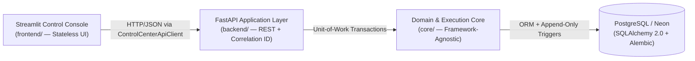

# Algo Trading Control Center

> [!IMPORTANT]
> **This application is an engineering demonstration using simulated/backtested execution. It does not provide investment advice and does not place real-money orders.**
>
> **FYERS is used only to retrieve historical market data. All executions displayed by the application are simulated paper executions. The platform does not place real orders.**
>
> **Persistent Safety Mode:** `PAPER TRADING | SIMULATED EXECUTION | NO REAL ORDERS` (`EXECUTION_MODE=PAPER_ONLY`)

---

## 1. Product Overview

**Algo Trading Control Center** is an institutional-style web operations console and trading automation backend built to demonstrate production-grade software engineering across the full algorithmic trading lifecycle on Indian index derivatives (`NIFTY` and `BANKNIFTY`):

```text
NIFTY / BANKNIFTY
    → Strategy Configuration & Immutable Versioning
    → Deterministic Zero-Lookahead Backtesting
    → 24/7 Normalized Market Replay Stream
    → Idempotent Signal Generation
    → Independent Fail-Closed Pre-Trade Risk Checks
    → OMS Order State Machine & Simulated Paper Broker
    → Execution-Derived Positions & Mark-to-Market P&L
    → Deterministic Ledger Reconciliation & 8-Stage Audit Trace
```

The system is intentionally engineered to showcase **operational safety, determinism, fail-closed risk governance, crash/restart recovery, ledger reconciliation, and end-to-end auditability** — never to claim or imply profitable trading parameters.

---

## 2. Architecture

The codebase enforces strict unidirectional layer boundaries verified continuously by AST static-analysis tests (`tests/unit/test_state_machines_and_architecture.py`):



### Architectural Invariants
- **Zero Business Logic in UI:** `frontend/` never imports `core/`, `backend/`, `sqlalchemy`, `alembic`, or `psycopg`. Every screen is a pure presentation client over REST.
- **Framework-Agnostic Domain Core:** `core/` never imports `fastapi` or `streamlit`. Strategy evaluation, backtesting, market replay, pre-trade risk, OMS state transitions, simulated fills, position accounting, and reconciliation live exclusively in `core/`.
- **Strategies Never Create Fills:** Strategies emit `SignalCandidate` objects only. Every trade must pass `Signal -> Risk Engine -> OMS -> Paper Broker -> Fill -> Position`.
- **Stateless Cloud-Ready Containers:** All state resides in PostgreSQL (`Neon` or local Postgres), enabling safe horizontal restarts on Google Cloud Run.
- **Canonical Timezone:** All timestamps across domain services, API payloads, and UI blotters operate in **`Asia/Kolkata` (`IST`, `UTC+05:30`)**, with ISO `UTC` (`Z`) additionally recorded on audit records for cross-system compliance.

---

## 3. Core Engineering Features

- **Configurable Strategy Lab (`EMA Crossover + RSI Confirmation`):** Strict Pydantic parameter validation, SHA-256 parameter hashing, clone lineage, side-by-side version diffing, and immutable `StrategyVersion` records (`NIFTY_EMA_RSI_v1`, `BANKNIFTY_EMA_RSI_v1`).
- **Deterministic Backtesting Engine:** Pre-backtest OHLCV Data Quality Validator (ordering, duplicates, session bounds, OHLC invariants, gaps), zero-lookahead bar-by-bar execution (`bar t` close signal $\rightarrow$ `bar t+1` open fill), adverse slippage, brokerage/statutory charges, reproducibility fingerprints, and `N/A` discipline for undefined ratios.
- **24/7 Market Replay Engine:** Streams historical `NIFTY` and `BANKNIFTY` 5m sessions as normalized `CandleEvent` objects (`1x`, `5x`, `10x`, `25x`, `50x`, `START`/`PAUSE`/`RESUME`/`STOP`/`RESET`/`+1 CANDLE`) with live `HEALTHY` / `STALE` / `STOPPED` freshness gating so client demos work even when NSE is closed.
- **Paper OMS, Simulated Broker & Execution-Derived Positions:** 11-state OMS state machine (`CREATED` $\rightarrow$ `RISK_APPROVED` $\rightarrow$ `SUBMITTED` $\rightarrow$ `ACKNOWLEDGED` $\rightarrow$ `PARTIALLY_FILLED` $\rightarrow$ `FILLED`, plus `RISK_REJECTED`, `REJECTED`, `CANCELLED`, `EXPIRED`, `FAILED`), `MARKET`/`LIMIT`/`STOP` fill matching, 4-layer idempotency, and HTTP `409` protection against direct position edits.
- **Independent Fail-Closed Risk Engine:** 25 operational, strategy-level, and account-level checks persisting an immutable `RiskDecision` on every order attempt, plus a persistent **Global Kill Switch** (blocks new orders immediately without silently auto-flattening open positions) and separate explicit-confirmation flatten controls.
- **P&L Analytics, Deterministic Reconciliation & 8-Stage Trace View:**
  - Full attribution (`Gross P&L`, `Charges`, `Slippage Cost`, `Realized P&L`, `Unrealized P&L`, `Net P&L`), 6 filters, and 5 interactive charts.
  - Non-silent `ReconciliationService` verifying `executions vs positions`, `open orders`, `position quantities`, and `realized P&L integrity` (`verify-only` by default; explicit `apply_repair=True` records exact `before -> after` diffs).
  - **End-to-End Correlation Trace View:** Reconstructs `1. Market Event -> 2. Signal -> 3. Risk Decision -> 4. Order -> 5. Execution -> 6. Position -> 7. Exit -> 8. Final P&L` from a single `Correlation ID`.
- **Guided 3–5 Minute Consulting Walkthrough:** Built-in 17-step presenter ribbon and deterministic showcase orchestrator (`/api/v1/demo/run-showcase` and `python -m demo_data.run_guided_demo`) demonstrating profitable trades, loss-making trades, risk rejections, stale-data blocking, kill-switch halts, recovery, and audit tracing without manipulating strategy logic.

---

## 4. Technology Stack

| Layer | Technology |
| :--- | :--- |
| **Language & Runtime** | Python 3.11+ (tested on Python 3.12 / 3.14) |
| **Backend API** | FastAPI, Pydantic v2, Uvicorn |
| **Control Console UI** | Streamlit, Plotly, Custom Institutional CSS (`frontend/theme/terminal.css`) |
| **Persistence & Migrations** | PostgreSQL 16 / Neon Serverless PostgreSQL, SQLAlchemy 2.0, Psycopg 3, Alembic |
| **Testing & Quality** | Pytest, FastAPI `TestClient`, Streamlit `AppTest`, Ruff, Mypy |
| **Containers & Cloud** | Docker (`Dockerfile.api`, `Dockerfile.ui`), Docker Compose, Google Cloud Run |

---

## 5. Console Screens (12 Operational Views)

1. **Dashboard:** 7-KPI capital/P&L strip (`₹5,00,000.00` DEMO capital), 5-subsystem health strip, persistent `STOP PAPER TRADING` control, running strategies, open positions, recent orders, live intraday P&L summary, and alerts.
2. **Strategy Lab:** `EMA Crossover + RSI Confirmation` specification, parameter/risk/cost panels, `Save New Version`, `Clone Version`, `Compare Versions`, and immutable version history.
3. **Backtests:** Dataset selector & CSV importer, Data Quality Report, `SIMULATED BACKTEST RESULTS` banner, 14 summary metrics, equity/drawdown/price-signal charts, and trade ledger.
4. **Market Replay:** Session & speed controls (`1x`–`50x`), normalized `CandleEvent` inspector, Wilder RSI & EMA rule checklist, market-data freshness gate (`HEALTHY`/`STALE`/`STOPPED`), and candlestick/RSI chart.
5. **Paper Trading:** Automated `StrategyInstance` launcher, manual `MARKET`/`LIMIT`/`STOP` paper ticket, recent signals, and simulated execution fills.
6. **Orders:** OMS order blotter, status/instrument filters, confirmation-gated `CANCEL ALL WORKING PAPER ORDERS`, and per-order state-transition audit trail.
7. **Positions:** Execution-derived open & closed position ledgers, mark-to-market P&L, holding durations, `EXIT POSITION`, `FLATTEN ALL OPEN`, and `RECONCILE BOOK`.
8. **Risk Center:** `DEMONSTRATION SETTINGS ONLY` banner, persistent `ACTIVATE / DEACTIVATE KILL SWITCH`, confirmation-gated `FLATTEN PAPER POSITIONS`, live account/strategy risk editors, and immutable `RiskDecision` blotter.
9. **P&L Analytics:** `SIMULATED PAPER-TRADING RESULTS` attribution (`Gross`, `Slippage`, `Charges`, `Realized`, `Unrealized`, `Net`), 6 filters, and 5 analytical charts (`Daily`, `Cumulative`, `Strategy`, `Instrument`, `Drawdown`).
10. **Audit Log:** Visual **8-Stage Trade Lifecycle Correlation Trace View** + append-only operational audit ledger (`UTC` & `IST` timestamps, 28 canonical `AuditEventType`s, structured JSON metadata).
11. **System Health:** 9-component operational diagnostic matrix (`API`, `Database`, `Market Replay`, `Market Data`, `Strategy Engine`, `Risk Engine`, `Paper Broker`, `Position Engine`, `Last Reconciliation`), DB telemetry, and Deterministic Reconciliation console.
12. **Settings:** Masked runtime configuration (zero exposed secrets) and editable PostgreSQL instrument reference specs (`NIFTY`, `BANKNIFTY`).

---

## 6. Local Setup

### 1. Create Virtual Environment & Install Package
```powershell
python -m venv .venv
.\.venv\Scripts\Activate.ps1
pip install --upgrade pip
pip install -e ".[dev]"
```

### 2. Configure Environment Variables
```powershell
Copy-Item .env.example .env
# Edit .env with your local PostgreSQL or Neon Serverless PostgreSQL DATABASE_URL
```

### 3. Apply Database Migrations
```powershell
.\.venv\Scripts\alembic.exe upgrade head
```

### 4. (Optional) Pre-Populate the Deterministic Consulting Demo Showcase
```powershell
.\.venv\Scripts\python.exe -m demo_data.run_guided_demo
```
*(You can also trigger this with one click from the sidebar **"Guided 3–5 Min Consulting Demo -> LOAD DETERMINISTIC DEMO SHOWCASE"** inside the UI.)*

### 5. Start FastAPI Backend & Streamlit Console
**Terminal 1 — FastAPI Backend:**
```powershell
.\.venv\Scripts\uvicorn.exe backend.main:app --host 127.0.0.1 --port 8000 --reload
```
**Terminal 2 — Streamlit Control Console:**
```powershell
$env:API_BASE_URL="http://127.0.0.1:8000"
.\.venv\Scripts\streamlit.exe run frontend/app.py --server.port 8501
```
Open `http://localhost:8501` (UI) or `http://localhost:8000/docs` (OpenAPI).

---

## 7. Environment Variables

All runtime settings are validated in `core/config.py` and documented in `.env.example`:

| Variable | Default / Example | Purpose |
| :--- | :--- | :--- |
| `EXECUTION_MODE` | `PAPER_ONLY` | **Locked.** Rejects startup if set to anything other than `PAPER_ONLY`. |
| `MARKET_MODE` | `HISTORICAL_AND_REPLAY` | Market feed operating mode (`HISTORICAL_AND_REPLAY`). |
| `TIMEZONE` | `Asia/Kolkata` | Canonical exchange & operational timezone (`IST`, `UTC+05:30`). |
| `DATABASE_URL` | `postgresql+psycopg://...` | PostgreSQL / Neon connection string (masked in logs, `/health`, and `/settings`). |
| `AUTO_SEED_REFERENCE_DATA` | `true` | Idempotently seeds `NIFTY`, `BANKNIFTY`, demo paper account, and v1 strategies on startup. |
| `DEFAULT_DEMO_CAPITAL_INR` | `500000.00` | Initial simulated paper capital (`DEMO / PAPER ONLY`). |
| `MARKET_DATA_STALE_THRESHOLD_SECONDS` | `10` | Maximum market-data age (`s`) before pre-trade gate blocks new orders. |
| `SIGNAL_EXPIRY_SECONDS` | `15` | Maximum signal age (`s`) before `MAX_SIGNAL_AGE` rejects execution. |
| `DEMO_MAX_DAILY_LOSS_INR` | `10000.00` | Default account intraday loss limit (`DEMONSTRATION SETTINGS ONLY`). |
| `DEMO_MAX_RISK_PER_TRADE_INR` | `2500.00` | Default strategy per-trade risk limit. |
| `DEMO_MAX_ORDER_VALUE_INR` | `3000000.00` | Maximum notional value per simulated paper order. |
| `REPLAY_WORKER_ENABLED` | `true` | Enables background async Market Replay progression loop. |
| `API_BASE_URL` | `http://localhost:8000` | Target FastAPI URL consumed by the stateless Streamlit UI container. |

---

## 8. Database Migrations

Schema evolution is managed strictly via Alembic (`migrations/versions/`):
- `0001_phase1_foundation.py` — Users, paper accounts, instruments, strategy definitions/versions, `audit_events`, `system_health_events`, and PL/pgSQL immutability triggers.
- `0002_strategy_lab_versioning.py` — Canonical version labels & clone lineage.
- `0003_phase2b_backtesting.py` — `historical_datasets`, `historical_candles`, `backtest_runs`, `backtest_trades` + immutability triggers.
- `0004_phase3a_market_replay.py` — `replay_sessions` and `signals`.
- `0005_phase3b_paper_trading_oms.py` — `strategy_instances`, `paper_orders`, `order_state_events`, `paper_fills`, `paper_positions`, `position_events` + immutability triggers.
- `0006_phase4_risk_engine_and_controls.py` — `account_risk_configs`, `strategy_risk_configs`, `risk_decisions` + immutability trigger.
- `0007_phase5_operational_visibility.py` — Structured trace columns on `audit_events` + immutable `reconciliation_runs` table & trigger.

Commands:
```powershell
# Apply all migrations
.\.venv\Scripts\alembic.exe upgrade head

# Generate offline PostgreSQL DDL for DBA review
.\.venv\Scripts\alembic.exe upgrade head --sql
```

---

## 9. Testing

Run the full automated verification suite (unit, integration, offline PostgreSQL DDL, downgrade/upgrade cycles, AST architecture boundaries, Final Quality Gate, and headless Uvicorn + Streamlit 12-screen `AppTest` scenario tests):

```powershell
.\.venv\Scripts\pytest.exe -v
```

---

## 10. Docker

Two structurally isolated images are provided:
- **`Dockerfile.api`:** Runs non-root `appuser` serving FastAPI (`core/`, `backend/`, `migrations/`, `demo_data/`).
- **`Dockerfile.ui`:** Runs non-root `uiuser` copying **only** `frontend/` and `.streamlit/` (physically incapable of importing `core/` or `backend/`).

Run the complete local stack (PostgreSQL 16 + one-shot Alembic migrator + API + UI):
```bash
cp .env.example .env
# Set POSTGRES_PASSWORD in .env
docker compose up --build
```

---

## 11. Cloud Deployment (Google Cloud Run OR Render Free + Neon PostgreSQL)

The repository supports **both** stateless container deployment targets out of the box using [`Dockerfile.api`](./Dockerfile.api) and [`Dockerfile.ui`](./Dockerfile.ui) backed by **Neon Serverless PostgreSQL**:

### Option A — Google Cloud Run + Neon PostgreSQL (`min-instances=0`)
Full runbook & checklists: [`docs/CLOUD_RUN_NEON_DEPLOYMENT.md`](./docs/CLOUD_RUN_NEON_DEPLOYMENT.md) (manifests in [`deploy/cloudbuild.yaml`](./deploy/cloudbuild.yaml), [`deploy/cloudrun-api.yaml`](./deploy/cloudrun-api.yaml), [`deploy/cloudrun-ui.yaml`](./deploy/cloudrun-ui.yaml)).

1. **Provision Database:** Create a Neon Serverless PostgreSQL database (`?sslmode=require`) and store `DATABASE_URL` in **Google Secret Manager**.
2. **Run Controlled Migrations (Cloud Run Job or CLI):**
   ```bash
   python -m deploy.run_migrations --seed
   ```
3. **Deploy Backend Service (`Dockerfile.api`):**
   ```bash
   gcloud builds submit --config=deploy/cloudbuild.yaml .
   gcloud run deploy atcc-api \
     --image REGION-docker.pkg.dev/PROJECT/algo-control-center/atcc-api:latest \
     --region asia-south1 --min-instances=0 --max-instances=2 --cpu-throttling \
     --set-env-vars APP_ENV=production,EXECUTION_MODE=PAPER_ONLY,TIMEZONE=Asia/Kolkata,MARKET_MODE=HISTORICAL_AND_REPLAY,DB_POOL_MODE=NULLPOOL,REPLAY_WORKER_ENABLED=false,AUTO_SEED_REFERENCE_DATA=false \
     --set-secrets DATABASE_URL=atcc-neon-database-url:latest
   ```
4. **Deploy Frontend Console (`Dockerfile.ui`):**
   ```bash
   gcloud run deploy atcc-ui \
     --image REGION-docker.pkg.dev/PROJECT/algo-control-center/atcc-ui:latest \
     --region asia-south1 --min-instances=0 --max-instances=2 --cpu-throttling \
     --set-env-vars API_BASE_URL=https://<atcc-api-cloud-run-url>,API_TIMEOUT_SECONDS=25.0
   ```

### Option B — Render Free Web Services + Neon PostgreSQL (Zero GCP Billing Required)
Full step-by-step runbook: [`RENDER_NEON_DEPLOYMENT.md`](./RENDER_NEON_DEPLOYMENT.md) | Blueprint: [`render.yaml`](./render.yaml) | Migration & Verification guides: [`deploy/render/MIGRATIONS.md`](./deploy/render/MIGRATIONS.md), [`deploy/render/verification.md`](./deploy/render/verification.md).

1. Run controlled migrations once against your **Neon Direct** connection string (`python -m deploy.run_migrations --seed`).
2. Connect your Git repository on Render using [`render.yaml`](./render.yaml) (or create two Free Docker Web Services: `atcc-api` using `./Dockerfile.api` with `/health/live`, and `atcc-ui` using `./Dockerfile.ui` with `/_stcore/health`).
3. Supply `DATABASE_URL` (Neon `-pooler` URL) securely on `atcc-api`, `API_BASE_URL` on `atcc-ui`, and lock `CORS_ALLOWED_ORIGINS` on `atcc-api` to your `atcc-ui` HTTPS origin.

---

## 12. Security & Operational Safety Notes

- **Hard `PAPER_ONLY` Execution Lock:** `AppSettings` (`core/config.py`) raises a validation error at process startup if `EXECUTION_MODE != "PAPER_ONLY"`. Zero external broker SDKs, order endpoints, or API credentials exist anywhere in the repository.
- **Zero Secret Leakage:** `.env` is excluded via `.dockerignore` and never committed. `AppSettings.masked_database_url` redacts credentials across logs, `/health`, and `/api/v1/settings`.
- **Append-Only Ledger Integrity:** `audit_events`, `strategy_versions`, `backtest_runs`, `backtest_trades`, `order_state_events`, `paper_fills`, `position_events`, `risk_decisions`, and `reconciliation_runs` are protected by both SQLAlchemy `before_update`/`before_delete` hooks and PostgreSQL PL/pgSQL triggers (`raise_append_only_violation()`), plus HTTP `409` mutation locks.
- **Fail-Closed Risk & Stale-Data Posture:** Missing/stale market data, expired signals, un-reconciled ledger drift, or active Kill Switch states immediately reject new paper orders with a persisted `RiskDecision`.

---

## 13. Known Limitations

- **Bar/OHLC Simulated Execution Model:** `PaperBrokerService` simulates latency, adverse slippage (`bps`), partial fill ratios, and strict `LIMIT` trade-through / `STOP` triggers over OHLCV bars rather than matching against a tick-level Level-2/Level-3 limit order book with queue-position priority.
- **Historical & Replay Market Scope:** V1 ships with deterministic historical CSV adapters and normalized `HistoricalCandleReplayFeed` (`NIFTY` and `BANKNIFTY` 5m IST datasets); live exchange WebSocket feed adapters are intentionally omitted from this paper-only demonstration.
- **Single-Desk Operator Context:** Operator actions record explicit actor attribution and `LOGIN` audit events suitable for a single-desk portfolio/consulting demonstration; multi-tenant RBAC/SSO (OIDC/IAP) should be placed in front of Cloud Run for shared enterprise deployments.
